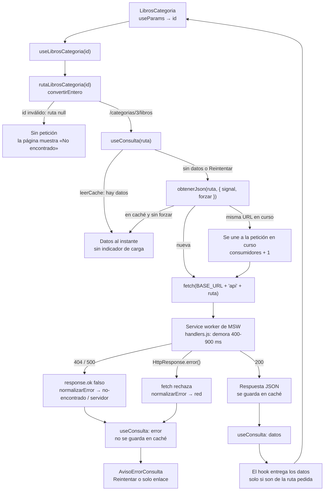
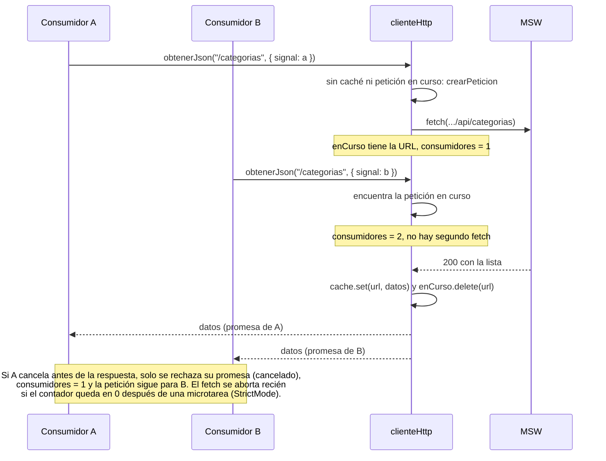
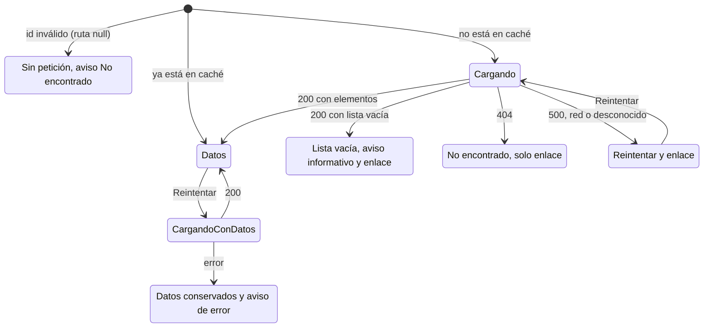
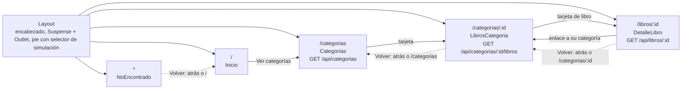

# Diagramas

Los diagramas usan Mermaid; GitHub los muestra directamente al abrir este archivo.

## 1. Recorrido de una petición

Ejemplo: la página de libros de una categoría. Las páginas nunca llaman a `fetch`: usan un hook, que usa el servicio y el cliente HTTP.

## 2. Dos consumidores que comparten una petición

El consumidor B pide la misma URL mientras la petición de A sigue en curso. Hay una sola petición de red, y cada consumidor recibe su propia promesa.

## 3. Estados de una consulta

Estados que ve una página que usa `useConsulta`. "Cargando con datos" es el reintento: los datos anteriores siguen visibles.

Al cambiar de parámetro (otra categoría u otro libro), la consulta anterior se cancela y la nueva parte desde el inicio. Los datos de la consulta anterior no se muestran bajo el nuevo título.

## 4. Mapa de rutas

Todas las páginas están dentro de `Layout` y se cargan de forma diferida; el `Suspense` envuelve solo el `Outlet`, así que el encabezado y el pie siguen visibles mientras se descarga una página.

"Volver" usa `useVolver(rutaDeRespaldo)`: navega hacia atrás si la página anterior es del sitio (`location.key !== "default"`); si se entró directo, va a la ruta de respaldo.
